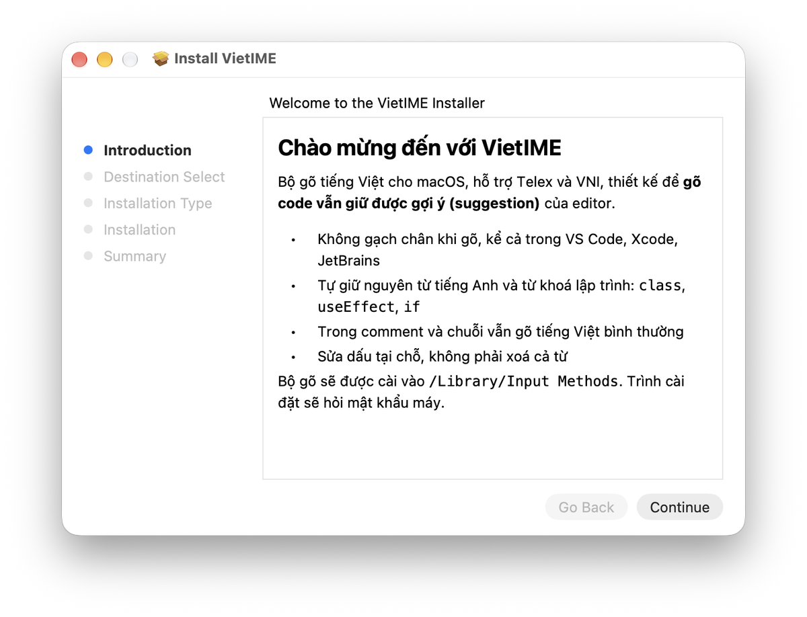

# VietIME

Bộ gõ tiếng Việt cho macOS, hỗ trợ **Telex** và **VNI**, được thiết kế để **gõ code vẫn giữ được gợi ý (suggestion) của editor**.

🌐 **Trang chủ:** https://phuongvudev.github.io/VietIME/ · ⬇ **Tải về:** [bản mới nhất](https://github.com/phuongvudev/VietIME/releases/latest)

*VietIME is a free Vietnamese input method (IME) for macOS, supporting Telex and VNI. It types without underlined text, so editor suggestions in VS Code, Xcode and JetBrains keep working while you code.*

  

## Tính năng

- **Không gạch chân khi gõ:** áp dụng ở mọi app, kể cả VS Code, Cursor, Xcode, JetBrains. Popup gợi ý, Tab/Enter để chọn gợi ý và tự đóng ngoặc vẫn chạy bình thường.
- **Gõ code thoải mái:** các từ tiếng Anh và từ khoá như `class`, `useEffect`, `if`, `max`, `test` được giữ nguyên.
- **Comment và chuỗi vẫn gõ tiếng Việt:** `// mã lỗi`, `"Đơn hàng đã xác nhận"`.
- **Gõ tự do:** dấu thanh, dấu mũ và dấu móc gõ ở cuối từ đều được (`vietej` → việt, `nguoiwf` → người). Có hai kiểu đặt dấu: kiểu mới (hoà, thuỷ) và kiểu cũ (hòa, thủy).
- **Sửa dấu tại chỗ:** đặt con trỏ vào một từ đã gõ rồi gõ phím dấu, không phải xoá cả từ.
- **Huỷ dấu nhanh:**
  - gõ lặp phím dấu để bỏ dấu: `texxt` → text;
  - gõ thêm `z` để ép bỏ dấu tiếng Việt: `maxz` → mã.
- **Chế độ riêng cho từng app,** bật/tắt nhanh bằng **Ctrl+Shift**.
- **Cài bằng file `.pkg`, gỡ ngay từ menu bộ gõ.**

## Cài đặt

Yêu cầu macOS 12 trở lên, chạy được trên cả Apple Silicon lẫn Intel.

1. Tải file **`VietIME-<phiên bản>.pkg`** ở trang [**Releases**](https://github.com/phuongvudev/VietIME/releases/latest).
2. Bấm đúp vào file, chọn **Continue** rồi **Install**, sau đó nhập mật khẩu máy.
3. Bấm biểu tượng bàn phím trên thanh menu và chọn **VietIME**. Biểu tượng sẽ đổi thành **Vi**. Bạn cũng có thể đổi bộ gõ nhanh bằng **Ctrl+Space** hoặc phím **🌐**.

**Chưa thấy VietIME trong danh sách bộ gõ?** Vào **System Settings → Keyboard → Input Sources → Edit…**, bấm **+**, chọn **Vietnamese** rồi chọn **VietIME**.

  
  &nbsp;
  

> **Mẹo:** ở màn hình trên, nên tắt **Correct spelling automatically**. Tính năng tự sửa chính tả của macOS kiểm tra theo tiếng Anh, nên có thể đổi chữ tiếng Việt vừa gõ thành chữ khác.

### Gõ thử

| Gõ | Kết quả |
|---|---|
| `tieengs Vieetj` | tiếng Việt |
| `nguowif` hoặc `nguoiwf` | người |
| `dduowcj` | được |

Xem bảng phím đầy đủ, cách gõ code, sửa dấu tại chỗ và các tuỳ chọn trong [**Hướng dẫn sử dụng**](docs/HUONG_DAN_SU_DUNG.md).

### Cập nhật

Tải file `.pkg` mới rồi cài đè lên bản cũ. Tuỳ chọn và từ điển của bạn được giữ nguyên.

Nếu sau khi cập nhật, chọn VietIME mà không gõ được:
1. Vào Input Sources, xoá **mọi** mục VietIME bằng nút **−**.
2. Log out rồi log in lại.
3. Thêm VietIME lại.

### Gỡ cài đặt

Bấm biểu tượng **Vi** trên thanh menu, chọn **Gỡ cài đặt VietIME…**, rồi chọn một trong hai:
- **Gỡ cài đặt:** gỡ bộ gõ, giữ lại tuỳ chọn.
- **Gỡ sạch:** gỡ bộ gõ và xoá luôn tuỳ chọn.

## Giấy phép

VietIME phát hành theo [giấy phép MIT](LICENSE). Bạn được tự do dùng, sửa và phân phối lại, kể cả cho mục đích thương mại, miễn là giữ lại thông báo bản quyền.

"UniKey" là tên của tác giả Phạm Kim Long. VietIME là một dự án độc lập, viết mới hoàn toàn.
