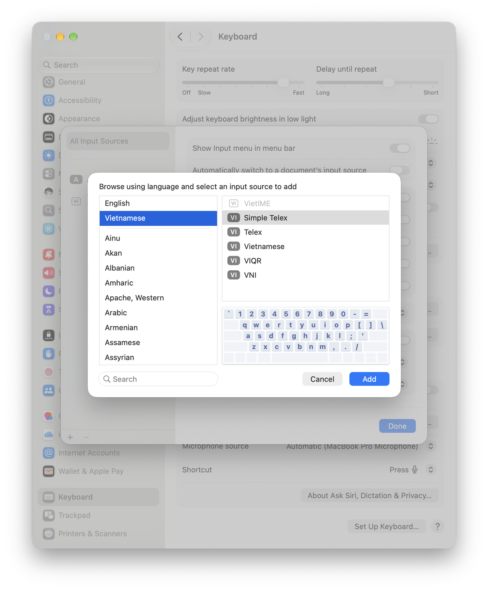
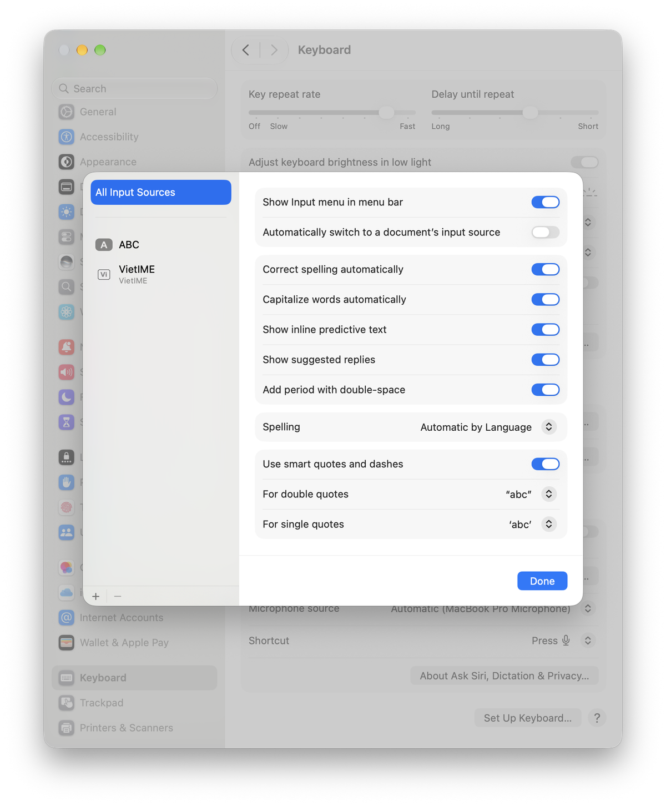
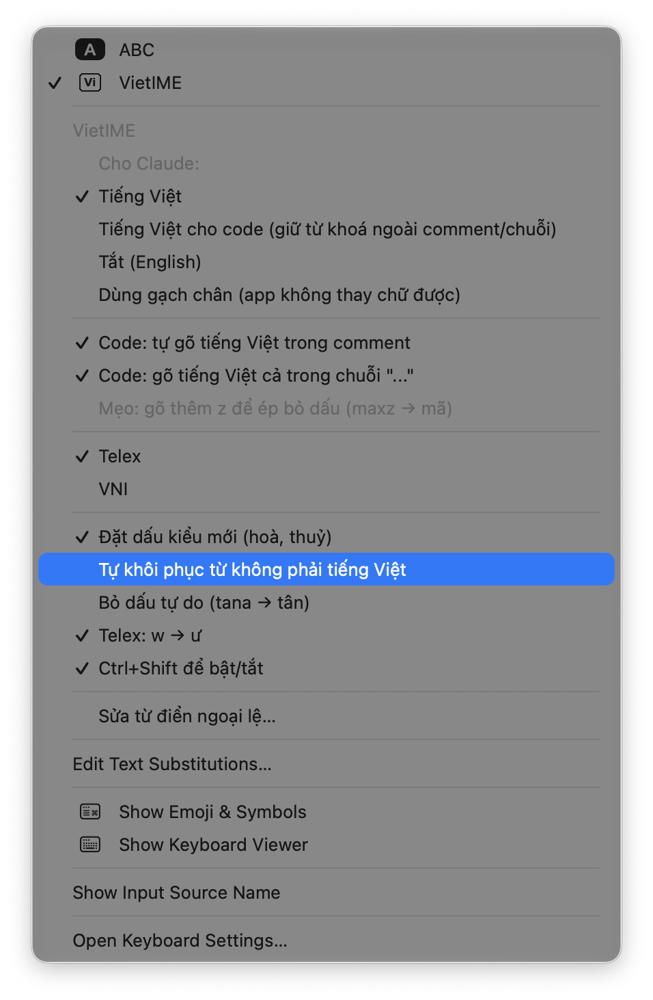

# VietIME

Bộ gõ tiếng Việt cho macOS (Telex / VNI), viết bằng InputMethodKit, thiết kế để **gõ code vẫn giữ được suggestion của editor**.

<p align="center">
  
</p>

- **Không gạch chân** khi gõ, kể cả trong VS Code, Cursor, Xcode, JetBrains. Popup gợi ý, Tab/Enter chọn gợi ý và tự đóng ngoặc vẫn chạy bình thường.
- **Code giữ nguyên tiếng Anh:** `class`, `useEffect`, `if`, `max`, `test` không bị bỏ dấu.
- **Comment và chuỗi gõ tiếng Việt bình thường:** `// mã lỗi`, `"Đơn hàng đã xác nhận"`.
- **Sửa dấu tại chỗ:** đặt con trỏ vào một từ đã gõ rồi gõ phím dấu, không phải xoá cả từ.
- **Gõ tự do:** gõ dấu thanh, dấu mũ, dấu móc ở cuối từ đều được (`vietej`, `nguoiwf`).
- **Chế độ riêng cho từng app**, bật/tắt nhanh bằng **Ctrl+Shift**.
- Cài bằng **file .pkg**, gỡ ngay từ menu bộ gõ.

👉 **Người dùng:** xem [Hướng dẫn sử dụng](docs/HUONG_DAN_SU_DUNG.md).

---

## Cài đặt

### Cách 1: file .pkg (khuyên dùng)

1. Tải file `VietIME-<version>.pkg` và bấm đúp. Với bản thử chưa ký, macOS sẽ chặn: vào **System Settings → Privacy & Security** → **Open Anyway**.
2. Bấm **Continue** → **Install**, rồi nhập mật khẩu máy.
3. Chọn **VietIME** ở biểu tượng bàn phím trên thanh menu.

Nếu chưa thấy VietIME, vào **System Settings → Keyboard → Input Sources → Edit… → + → Vietnamese → VietIME**:

<p align="center">
  
  &nbsp;
  
</p>

> Nên tắt **Correct spelling automatically** ở màn hình này. Tính năng tự sửa chính tả của macOS kiểm tra theo tiếng Anh, nên có thể "sửa" chữ tiếng Việt vừa gõ thành chữ khác.

Xem chi tiết từng bước trong [Hướng dẫn sử dụng](docs/HUONG_DAN_SU_DUNG.md#1-cài-đặt).

### Cách 2: build từ mã nguồn

Cần Xcode và [XcodeGen](https://github.com/yonaskolb/XcodeGen):

```bash
brew install xcodegen
./scripts/install.sh          # build + cài vào ~/Library/Input Methods + đăng ký
```

Sửa code xong thì chạy lại `./scripts/install.sh`, không cần log out. Nếu app đang mở vẫn dùng bản cũ, thoát app đó (⌘Q) rồi mở lại.

### Đóng gói .pkg

```bash
./scripts/make_installer.sh   # → dist/VietIME-<version>.pkg (Universal: Apple Silicon + Intel)
```

- **Gói .pkg làm gì khi cài:**
  - Cài bộ gõ vào `/Library/Input Methods`, rồi đăng ký và bật luôn cho người đang đăng nhập.
  - Tự tắt bản cũ đang chạy.
  - Xoá bản cài kiểu dev trong `~/Library/Input Methods` để không hiện 2 VietIME.
- **Gói chưa ký:** máy khác sẽ bị Gatekeeper chặn. Trên macOS 15 trở lên, chuột phải → Open không còn tác dụng; người dùng phải vào Privacy & Security → **Open Anyway**.
- **Phát hành cho người dùng phổ thông:** ký bằng Developer ID và notarize. Xem quy trình đầy đủ trong [docs/PHAT_HANH.md](docs/PHAT_HANH.md). Tóm tắt:

```bash
export APP_SIGN_ID="Developer ID Application: Ten Ban (TEAMID)"
export PKG_SIGN_ID="Developer ID Installer: Ten Ban (TEAMID)"
export NOTARY_PROFILE="vietime"
./scripts/make_installer.sh
```

### Cập nhật từ bản cũ

Cài đè file `.pkg` mới lên là được. Tuỳ chọn và từ điển ngoại lệ được giữ nguyên.

Từ bản 0.3.1, bundle ID đổi thành `com.openmobilekit.inputmethod.VietIME`. Bản cũ dùng `com.vuphuong.inputmethod.VietIME`. Khi cập nhật từ bản cũ:
- Tuỳ chọn được tự chép sang bản mới ở lần chạy đầu.
- Mục VietIME của bản cũ trong Input Sources được tự tắt.

Nếu chọn VietIME mà không gõ được, hoặc thấy 2 mục VietIME: vào Input Sources, xoá **mọi** mục VietIME bằng nút **−**, log out rồi log in lại, sau đó thêm VietIME lại. Lỗi này xảy ra vì macOS vẫn nhớ chỗ cài cũ của bộ gõ (chẳng hạn bản dev trong `~/Library/Input Methods` vừa bị bộ cài xoá).

### Gỡ cài đặt

- Bản cài bằng .pkg: menu **Vi** → **Gỡ cài đặt VietIME…**
- Bản dev, hoặc gỡ từ Terminal:

```bash
./scripts/uninstall.sh            # giữ tuỳ chọn và từ điển ngoại lệ
./scripts/uninstall.sh --purge    # xoá sạch
```

---

## Cách hoạt động

### Thay chữ trực tiếp thay vì marked text

Phần lớn phím được chuyển thẳng cho app chèn (passthrough). Chỉ khi cần bỏ dấu, bộ gõ mới gọi `insertText(_:replacementRange:)` để thay **đúng mấy ký tự vừa đổi**. Ví dụ gõ `tiee` thì chỉ thay `e` → `ê`. Editor thấy từng ký tự ngay lập tức, nên suggestion hoạt động như khi gõ tiếng Anh.

Với những app không hỗ trợ `replacementRange` (Terminal, iTerm, Warp, kitty, Ghostty…), bộ gõ tự chuyển sang marked text (có gạch chân).

### Engine dựng lại từ phím thô

Engine giữ lại chuỗi phím thô của từ đang gõ. Mỗi lần có phím mới, nó dựng lại cả từ từ chuỗi phím đó, rồi so tiền tố với chữ đang hiển thị để ra kết quả "xoá N ký tự, chèn S". Cách này giúp:

- **Dấu thanh tính theo cả âm tiết:** vị trí dấu luôn được tính lại, theo kiểu mới (hoà, thuỷ) hoặc kiểu cũ (hòa, thủy).
- **Khôi phục tiếng Anh chỉ là trả lại phím thô.** Bộ gõ trả lại phím thô khi:
  - từ không phải âm tiết tiếng Việt hợp lệ (có kiểm tra chính tả c/k, g/gh, ng/ngh, phụ âm cuối, dấu thanh đi với c/ch/p/t);
  - từ có dạng camelCase;
  - từ nằm trong từ điển ngoại lệ.
- **Gõ lặp liền phím để huỷ dấu** (`texxt` → text). Riêng các từ tiếng Anh có chữ đôi như `pass`, `class`, `error`, `offset` vẫn được giữ nguyên.

### Menu bộ gõ

Mọi tuỳ chọn nằm trong menu của biểu tượng **Vi** trên thanh menu, áp dụng ngay, không cần cửa sổ cài đặt riêng:

<p align="center">
  
</p>

### Nhận biết ngữ cảnh code

Ở đầu mỗi từ, bộ gõ đọc tối đa 4000 ký tự trước con trỏ để đoán con trỏ đang ở code, comment hay chuỗi:

- **Comment:** `//`, `#`, `--`, `/* */`, `<!-- -->`, dòng `* ` của doc comment, dòng Markdown.
- **Chuỗi:** `"…"`, `'…'`, `` `…` ``, chuỗi 3 dấu nháy.

Ở code thì bật từ điển ngoại lệ (khoảng 120 từ như `if is as max test var`). Trong comment và chuỗi thì tắt, nên gõ được `mã`, `tét`… bình thường.

---

## Cấu trúc

```
VietEngine/                       Swift Package
  Sources/CVietEngine/            Lõi C — không phụ thuộc macOS, test được ở mọi nơi
    viet_engine.c                 Telex/VNI, đặt dấu, chính tả, khôi phục, sửa dấu tại chỗ
    context.c                     Nhận biết code / comment / chuỗi
    english_words.c               Từ điển ngoại lệ cho chế độ code
    english_doubles.c             Từ tiếng Anh có ss/ff/rr (phân biệt "pass" với "nhass")
  Sources/VietEngine/             Lớp Swift bọc lõi C
  ctests/                         Test + fuzz cho lõi C
  Tests/                          XCTest
App/
  Sources/InputController.swift   IMK: direct/marked, kiểm tra con trỏ, sửa dấu tại chỗ, menu
  Sources/Settings.swift          Tuỳ chọn, chế độ theo app, từ điển người dùng
  Sources/ModeHUD.swift           HUD "VI"/"EN" khi bấm Ctrl+Shift
  Sources/Uninstaller.swift       Gỡ cài đặt từ menu
  Resources/                      Icon, uninstall-helper.sh
  Info.plist                      Khai báo bộ gõ (bundle ID phải chứa ".inputmethod.")
installer/                        Trang chào/kết thúc, pre/postinstall của gói .pkg
scripts/                          install.sh · uninstall.sh · make_installer.sh
tools/                            Corpus tiếng Việt + công cụ test hàng loạt, sinh từ điển
docs/                             Hướng dẫn sử dụng, quy trình phát hành (PHAT_HANH.md), ảnh chụp màn hình
```

## Test

```bash
cd VietEngine
make test        # >230 ca: Telex, VNI, dấu cũ/mới, code, backspace, phím z, comment/chuỗi, sửa dấu
make fuzz        # 40.000 lượt gõ ngẫu nhiên (có cả Backspace và sửa dấu tại chỗ), ASan + UBSan
swift test       # XCTest qua lớp Swift
cd .. && ./tools/run_corpus.sh   # gõ ~440 từ trong tools/corpus_vi.txt theo 8 kiểu khác nhau
```

Gặp từ gõ sai thì thêm câu chứa từ đó vào `tools/corpus_vi.txt` rồi chạy lại `run_corpus.sh`.

### Kiểm tra trên app thật

| App | Kiểu chèn | `tieengs` | Suggestion khi gõ `useEffect` | `// mã` | Sửa dấu tại chỗ |
|---|---|---|---|---|---|
| VS Code / Cursor | direct | | | | |
| Xcode | direct | | | | |
| JetBrains | direct | | | | |
| Zed | direct | | | | |
| Chrome / Safari | direct | | | | |
| Notes, Slack, Claude | direct | | | | |
| Terminal / iTerm | marked | | — | | — |

### Chẩn đoán lỗi

Bật **Ghi log chẩn đoán** trong menu bộ gõ, rồi chạy:

```bash
log stream --predicate 'subsystem == "com.openmobilekit.inputmethod.VietIME"' --level debug
```

Mỗi phím ghi một dòng: vị trí con trỏ, từ trước và sau, chữ được thay, và lý do nếu bộ gõ bắt đầu từ mới. Muốn debug bằng Xcode: Debug → Attach to Process → VietIME.

## Giới hạn đã biết

- Nhận biết comment/chuỗi là heuristic, nên có thể đoán sai, ví dụ ở giữa một block comment rất dài.
- Nếu app không trả được text quanh con trỏ, bộ gõ coi như đang ở code. Khi đó gõ thêm `z` để ép bỏ dấu (`maxz` → mã).
- Chuỗi mặc định gõ tiếng Việt, nên class Tailwind `"max-w-md"` sẽ thành `mã-w`. Có thể tắt tuỳ chọn này trong menu.
- 21 từ tiếng Anh như `car`, `sex`, `there`, `own` vẫn bị bỏ dấu ở chế độ code, vì chữ tiếng Việt tương ứng quá phổ biến (cả, sẽ, thể, ơn). Gõ lặp phím dấu để giữ tiếng Anh: `carr`.
- Không gõ được trong ô mật khẩu. Đây là hành vi của macOS (Secure Input), không phải lỗi.

## Ghi chú

"UniKey" là tên của tác giả Phạm Kim Long, nên dự án dùng tên VietIME. Lõi engine được viết mới hoàn toàn, không dùng mã GPL của UniKey hay OpenKey.
