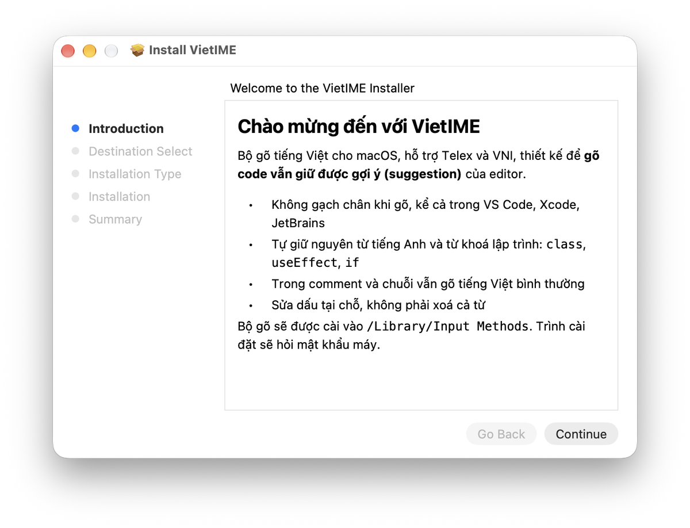
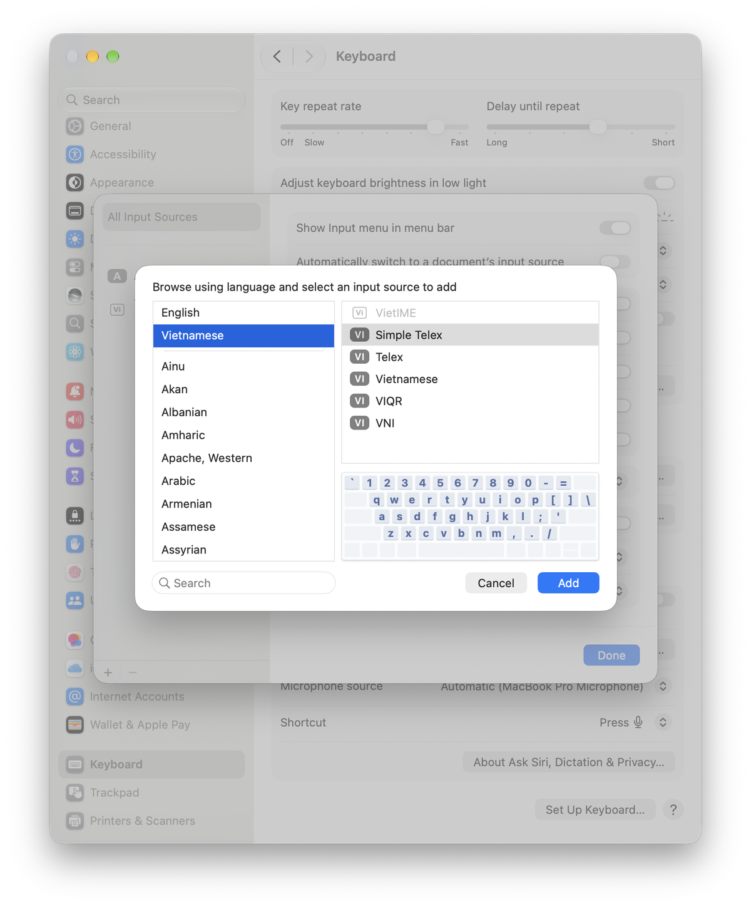
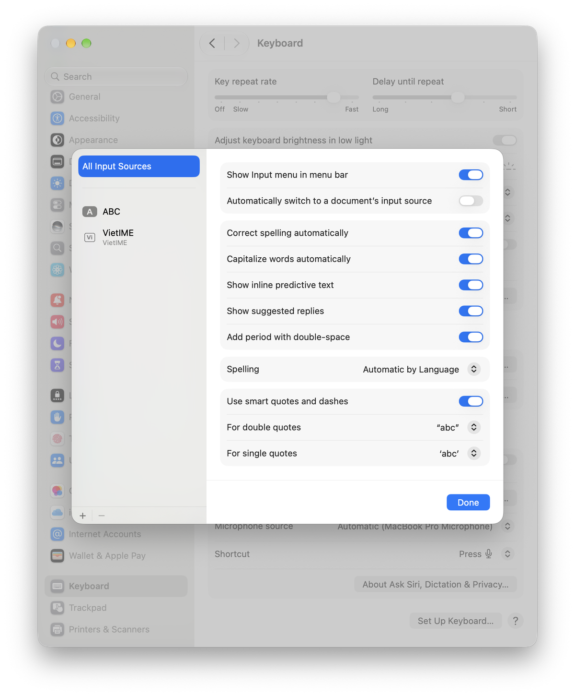
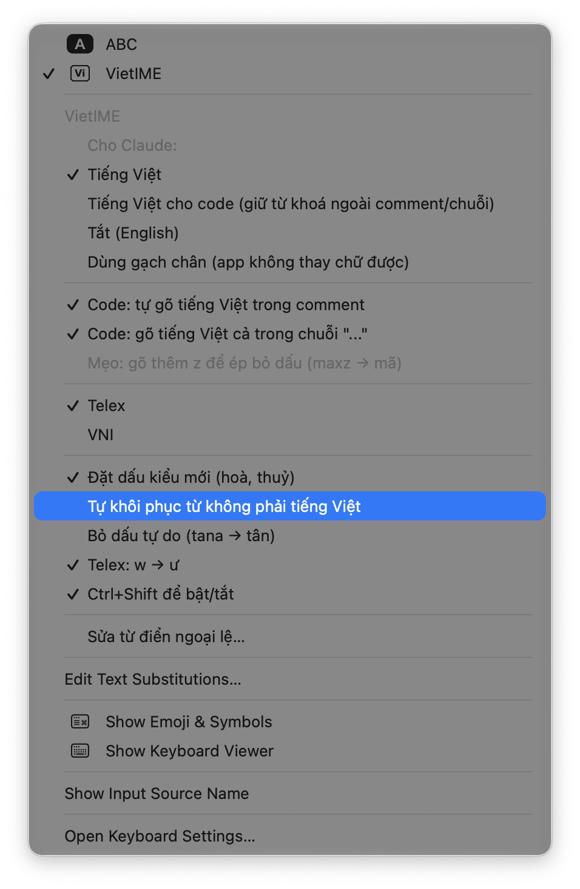

# Hướng dẫn sử dụng VietIME

VietIME là bộ gõ tiếng Việt cho macOS (Telex và VNI). Dùng như bộ gõ bình thường cho tin nhắn và văn bản, và gõ code thoải mái mà editor vẫn hiện gợi ý.

**Mục lục**
1. [Cài đặt](#1-cài-đặt)
2. [Bật bộ gõ](#2-bật-bộ-gõ)
3. [Gõ tiếng Việt](#3-gõ-tiếng-việt)
4. [Gõ khi viết code](#4-gõ-khi-viết-code)
5. [Sửa dấu tại chỗ](#5-sửa-dấu-tại-chỗ)
6. [Bật/tắt nhanh và chế độ theo app](#6-bậttắt-nhanh-và-chế-độ-theo-app)
7. [Menu bộ gõ](#7-menu-bộ-gõ)
8. [Từ điển ngoại lệ](#8-từ-điển-ngoại-lệ)
9. [Gỡ cài đặt](#9-gỡ-cài-đặt)
10. [Xử lý sự cố](#10-xử-lý-sự-cố)

---

## 1. Cài đặt

Yêu cầu macOS 12 trở lên, máy Apple Silicon hoặc Intel đều được.

1. Bấm đúp file **`VietIME-<version>.pkg`**.
   > Nếu macOS báo *không mở được vì không xác minh được nhà phát triển* (chỉ gặp với bản thử chưa ký): bấm **Done**, mở **System Settings → Privacy & Security**, kéo xuống cuối, bấm **Open Anyway** rồi nhập mật khẩu.
2. Bấm **Tiếp tục** (*Continue*) ở trang giới thiệu.

   

3. Bấm **Cài đặt** (*Install*), nhập mật khẩu máy.
4. Thấy trang **Đã cài xong VietIME** là xong. Không cần khởi động lại máy hay log out.

   

Muốn cập nhật lên bản mới, chỉ cần mở file `.pkg` mới và cài đè lên. Tuỳ chọn và từ điển của bạn được giữ nguyên.

## 2. Bật bộ gõ

Bấm biểu tượng bàn phím trên thanh menu và chọn **VietIME**. Biểu tượng sẽ đổi thành **Vi**.


Đổi qua lại giữa VietIME và bàn phím khác bằng **Ctrl+Space** hoặc phím **🌐 (Globe)**, như với các bộ gõ khác.

Nếu chưa thấy VietIME trong danh sách, thêm bằng tay:

1. Vào **System Settings → Keyboard → Input Sources → Edit…**, bấm **+** ở góc dưới bên trái.
2. Chọn **Vietnamese**, rồi chọn **VietIME** (dòng có biểu tượng **Vi**) và bấm **Add**.

   

   Nếu dòng VietIME bị mờ thì bộ gõ đã được thêm rồi.

3. VietIME hiện trong danh sách bên trái là xong.

   

> **Nên tắt** *Correct spelling automatically* (tự sửa chính tả) và *Show inline predictive text* ở màn hình này. Tính năng tự sửa của macOS kiểm tra theo tiếng Anh, nên có thể tự "sửa" chữ tiếng Việt vừa gõ thành chữ khác.

## 3. Gõ tiếng Việt

### Telex (mặc định)

| Gõ | Ra | | Gõ | Ra |
|---|---|---|---|---|
| `s` | sắc (á) | | `aa` | â |
| `f` | huyền (à) | | `ee` | ê |
| `r` | hỏi (ả) | | `oo` | ô |
| `x` | ngã (ã) | | `aw` | ă |
| `j` | nặng (ạ) | | `ow` | ơ |
| `z` | xoá dấu thanh | | `uw` hoặc `w` | ư |
| | | | `dd` | đ |

**Ví dụ:** `tieengs Vieetj` → tiếng Việt · `nguowif` → người · `dduowcj` → được · `DDAF NAWNGX` → ĐÀ NẴNG

**Gõ tự do:** dấu thanh, dấu mũ và dấu móc đều gõ được ở cuối từ. Bộ gõ tự đặt dấu vào đúng chỗ:

| Cách gõ | Kết quả |
|---|---|
| `vieetj`, `viejet`, `vietej`, `Viejte` | việt |
| `nguowif`, `nguoiwf`, `nguwowif` | người |
| `tieengs`, `tiengse` | tiếng |

**Huỷ dấu:** gõ lặp liền phím dấu đó, bộ gõ trả lại chữ thường:

| Gõ | Ra |
|---|---|
| `nhass` | nhas |
| `texxt` | text |
| `aaa` | aa |
| `ddd` | dd |
| `uww` | uw |

### VNI

Đổi sang VNI trong menu bộ gõ. Các phím số dùng để bỏ dấu:
- `1` sắc, `2` huyền, `3` hỏi, `4` ngã, `5` nặng, `0` xoá dấu thanh
- `6` dấu mũ (â ê ô), `7` dấu móc (ơ ư), `8` dấu trăng (ă), `9` đ

**Ví dụ:** `vie65t` → việt, `d9u7o7c5` → được.

### Kiểu đặt dấu

Mặc định là **kiểu mới**: hoà, thuỷ, khoẻ. Muốn dùng **kiểu cũ** (hòa, thủy, khỏe) thì bỏ chọn **Đặt dấu kiểu mới** trong menu.

## 4. Gõ khi viết code

Ở các app lập trình như VS Code, Cursor, Xcode, JetBrains, Zed và Terminal, bộ gõ tự chuyển sang **chế độ code**:


```js
// Lấy danh sách đơn hàng, tối đa 10 mã          ← comment: gõ tiếng Việt bình thường
const maxItems = 10;                              ← code: max, const giữ nguyên
export async function fetchOrders(userId) {
  if (!userId) return [];                         ← if, return giữ nguyên
  throw new Error("Mã đơn hàng không hợp lệ");    ← chuỗi: gõ tiếng Việt bình thường
}
```

- **Từ tiếng Anh và từ khoá giữ nguyên**, ví dụ `class`, `useEffect`, `function`, `if`, `is`, `max`, `test`, `var`. Editor vẫn hiện gợi ý và **Tab/Enter** vẫn chọn gợi ý như bình thường.
- **Comment và chuỗi được gõ tiếng Việt bình thường.**
- **Bộ gõ đoán sai** thì sửa ngay khi đang gõ:

| Muốn | Cách gõ | Ví dụ |
|---|---|---|
| Ép thành tiếng Việt | gõ thêm `z` | `maxz` → mã, `testz` → tét |
| Giữ tiếng Anh | gõ lặp phím dấu | `maxx` → max, `tesst` → test |

> Nếu hay gõ class Tailwind trong chuỗi, ví dụ `"max-w-md"` bị thành `mã-w`, hãy bỏ chọn **Code: gõ tiếng Việt cả trong chuỗi "..."** trong menu.

Ở ngoài chế độ code (Notes, Slack…), các từ như `test`, `max` sẽ được bỏ dấu thành tét, mã. Muốn giữ tiếng Anh thì gõ `tesst`, `maxx`.

## 5. Sửa dấu tại chỗ

Gõ sai dấu thì **không cần xoá cả từ**. Click hoặc dùng phím mũi tên để đặt con trỏ vào từ đó, rồi gõ phím dấu:

| Con trỏ đặt ở | Gõ | Kết quả |
|---|---|---|
| `việt│` | `s` | viết |
| `viết│` | `z` | viêt |
| `viet│` | `ej` | việt |
| `nguoi│` | `wf` | người |
| `di│` | `d` | đi |
| `việ│t` (giữa từ) | `s` | viế│t (con trỏ đứng yên) |

Con trỏ phải **sát** từ: nếu có dấu cách ở giữa thì bộ gõ hiểu là bắt đầu từ mới. Ở giữa từ, bộ gõ chỉ nhận các phím dấu (`s f r x j z a e o w d`, hoặc phím số với VNI).

> Tính năng này cần app cho phép bộ gõ đọc chữ quanh con trỏ. Hầu hết app đều cho phép, nhưng Terminal thì không. Tắt bằng mục **Sửa dấu từ đã gõ** trong menu.

## 6. Bật/tắt nhanh và chế độ theo app

**Ctrl+Shift** (nhấn cùng lúc rồi thả): bật/tắt tiếng Việt cho **app đang dùng**. Một ô nhỏ **VI** hoặc **EN** hiện cạnh con trỏ để báo trạng thái.


Mỗi app nhớ chế độ riêng. Ví dụ tắt trong Terminal thì Slack vẫn gõ tiếng Việt. Có 3 chế độ, chọn trong menu bộ gõ:

| Chế độ | Dùng cho |
|---|---|
| **Tiếng Việt** | Tin nhắn, văn bản: gõ tiếng Việt bình thường, từ không phải tiếng Việt thì tự giữ nguyên |
| **Tiếng Việt cho code** | Editor, terminal: giữ từ khoá ngoài comment/chuỗi (mặc định cho app lập trình) |
| **Tắt (English)** | Không bỏ dấu |

## 7. Menu bộ gõ

Bấm biểu tượng **Vi** trên thanh menu:



| Mục | Ý nghĩa |
|---|---|
| Tiếng Việt / Tiếng Việt cho code / Tắt | Chế độ cho app hiện tại (mục 6) |
| Dùng gạch chân | Bật cho app nào gõ ra chữ thừa kiểu "tieêe" |
| Code: tự gõ tiếng Việt trong comment | Chế độ code: comment được gõ tiếng Việt |
| Code: gõ tiếng Việt cả trong chuỗi "..." | Chế độ code: chuỗi được gõ tiếng Việt |
| Telex / VNI | Kiểu gõ |
| Đặt dấu kiểu mới | hoà/thuỷ (bật) hay hòa/thủy (tắt) |
| Tự khôi phục từ không phải tiếng Việt | Giữ nguyên `class`, `pass`… **Nên để bật** |
| Bỏ dấu tự do | Cho phép `tana` → tân, `dida` → đia |
| Telex: w → ư | Gõ `w` đứng riêng ra ư |
| Ctrl+Shift để bật/tắt | Bật/tắt phím tắt |
| Sửa dấu từ đã gõ | Mục 5 |
| Sửa từ điển ngoại lệ… | Mục 8 |
| Ghi log chẩn đoán | Dùng khi báo lỗi (mục 10) |
| Gỡ cài đặt VietIME… | Mục 9 |
| VietIME x.y.z | Phiên bản đang chạy |

## 8. Từ điển ngoại lệ

Từ điển ngoại lệ là danh sách các từ luôn giữ nguyên tiếng Anh ở **chế độ code**. Mở bằng menu → **Sửa từ điển ngoại lệ…**. Mỗi dòng một từ:

```
kotlin      # thêm: luôn giữ nguyên chữ kotlin
-max        # bỏ khỏi danh sách có sẵn → gõ được "mã" ở mọi chỗ
```

Lưu file, chuyển sang app khác rồi quay lại là có hiệu lực.

## 9. Gỡ cài đặt

Vào menu **Vi** → **Gỡ cài đặt VietIME…**:


- **Gỡ cài đặt:** xoá bộ gõ, giữ lại tuỳ chọn và từ điển để lần sau cài lại vẫn còn.
- **Gỡ sạch:** xoá tất cả.

Nhập mật khẩu là xong. Nếu biểu tượng **Vi** vẫn còn trên thanh menu, log out rồi log in lại.

## 10. Xử lý sự cố

| Hiện tượng | Cách xử lý |
|---|---|
| Không thấy VietIME trong danh sách bàn phím | System Settings → Keyboard → Input Sources → Edit… → **+** → Vietnamese → VietIME. Vẫn không thấy thì log out rồi log in lại. |
| Chọn VietIME mà không gõ được (sau khi cài hoặc cập nhật) | macOS vẫn nhớ chỗ cài cũ của bộ gõ. Vào Input Sources, xoá **mọi** mục VietIME bằng nút **−**, **log out rồi log in lại**, rồi thêm VietIME lại (**+** → Vietnamese → VietIME). |
| Cài bản mới mà vẫn thấy hành vi cũ | Mở menu và xem số phiên bản. Thoát app đang gõ (⌘Q) rồi mở lại. |
| Một app gõ ra chữ thừa (`tieêe`) | Menu → bật **Dùng gạch chân** cho app đó |
| Từ tiếng Anh bị bỏ dấu | Gõ lặp phím dấu (`maxx`), hoặc thêm từ đó vào từ điển ngoại lệ |
| Muốn gõ tiếng Việt mà bộ gõ giữ tiếng Anh | Gõ thêm `z` (`maxz` → mã) |
| Chữ tự đổi thành chữ khác sau khi gõ dấu cách | Đó là tính năng tự sửa chính tả của macOS. Tắt **Correct spelling automatically** trong System Settings → Keyboard → Input Sources → Edit… |
| Ô mật khẩu không gõ được dấu | Đây là hành vi của macOS (Secure Input), không phải lỗi |

**Báo lỗi:** bật **Ghi log chẩn đoán** trong menu, mở Terminal và chạy lệnh dưới đây, gõ lại chỗ bị lỗi, rồi gửi log kèm **tên app** và **các phím đã gõ**:

```bash
log stream --predicate 'subsystem == "com.openmobilekit.inputmethod.VietIME"' --level debug
```
